# Three-Tier Docker Application on AWS EC2

## Introduction

This project demonstrates the deployment of a Three-Tier Web Application using Docker, Docker Compose, Nginx, PHP, and MySQL on an Amazon EC2 Linux instance.

The application follows a three-tier architecture consisting of:

- **Presentation Tier:** Nginx web server serving the signup page.
- **Application Tier:** PHP application handling form submissions and application logic.
- **Database Tier:** MySQL database storing application data.

Docker containers are organized using two separate Docker networks: Frontend and Backend. These networks provide communication between application components while maintaining logical network isolation.

Docker Compose is used to manage the multi-container application through a single configuration file.

This hands-on project helps understand containerization, Docker networking, multi-tier architecture, application deployment, database connectivity, and AWS cloud infrastructure.

---

# Project Objective

The primary objectives of this project are to:

- Deploy a three-tier web application using Docker.
- Launch and configure an Amazon EC2 Linux instance.
- Create and configure Docker containers for Nginx, PHP, and MySQL.
- Create two isolated Docker networks: Frontend and Backend.
- Configure communication between application tiers.
- Use Docker Compose to manage multiple containers.
- Connect the PHP application with the MySQL database.
- Test the signup application and database connectivity.
- Understand containerized application architecture.

---

# Architecture Diagram

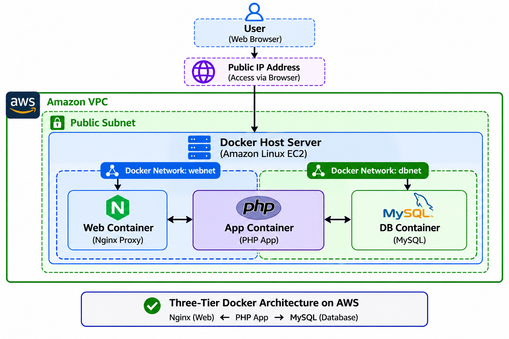

### Architecture Overview

The application consists of three logical layers:

1. **Web Tier:** Nginx handles incoming HTTP requests and serves the signup page.
2. **Application Tier:** PHP processes form submissions and communicates with the database.
3. **Database Tier:** MySQL stores application information.

### Docker Network Architecture

- **Frontend Network:** Used for communication between the web and application tiers.
- **Backend Network:** Used for communication between the application and database tiers.

The PHP application acts as the communication layer between the web server and database.

---

# Services and Technologies Used

| Service / Technology    | Purpose                               |
| ----------------------- | ------------------------------------- |
| Amazon EC2              | Hosts the Docker application          |
| Amazon Linux            | Operating system                      |
| Docker                  | Containerization platform             |
| Docker Compose          | Multi-container management            |
| Nginx                   | Web server                            |
| PHP                     | Application processing                |
| MySQL                   | Database management                   |
| Docker Frontend Network | Web-to-application communication      |
| Docker Backend Network  | Application-to-database communication |
| Git                     | Version control                       |
| GitHub                  | Source code hosting                   |

---

# Project Directory Structure

```text
three-tier-docker-application/
│
├── app/
│   └── code/
│       └── submit.php
│
├── db/
│   ├── Dockerfile
│   └── init.sql
│
├── docker-compose.yaml
│
└── web/
    ├── code/
    │   └── signup.html
    │
    └── config/
        └── default.conf
```

### Directory Explanation

| File / Directory        | Purpose                                  |
| ----------------------- | ---------------------------------------- |
| app/code/submit.php     | Handles application form submissions     |
| db/Dockerfile           | Defines the database container image     |
| db/init.sql             | Initializes database structures          |
| docker-compose.yaml     | Defines and manages application services |
| web/code/signup.html    | Signup page for users                    |
| web/config/default.conf | Nginx server configuration               |

---

# Prerequisites

Before starting this project, ensure the following:

- AWS Account
- Amazon Linux EC2 Instance
- SSH Access to EC2
- Docker Installed
- Docker Compose Available
- Basic Linux Command Knowledge
- Basic HTML and PHP Knowledge
- Basic MySQL Knowledge
- Git Installed
- GitHub Account

---

# Implementation Steps

## Step 1: Launch an Amazon EC2 Instance

### Objective

Launched an Amazon EC2 instance using Amazon Linux to host the Docker-based application.

### Configuration

| Parameter        | Value                    |
| ---------------- | ------------------------ |
| Instance Name    | three-tier-docker-server |
| Operating System | Amazon Linux             |
| Instance Type    | As configured in AWS     |
| Platform         | AWS EC2                  |
| Deployment       | Docker-based application |
| Access Method    | SSH                      |

### Purpose

Amazon EC2 provides the virtual Linux environment required to install Docker and deploy the application.

### Screenshot

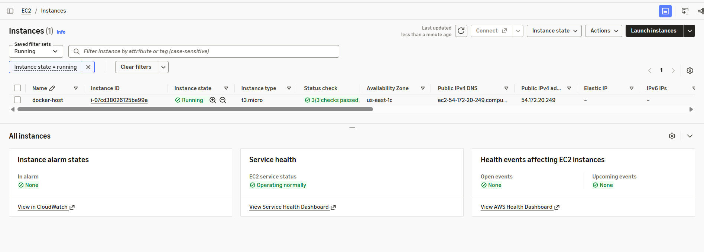

---

## Step 2: Connect to EC2 Using SSH

### Objective

Connected to the Amazon Linux EC2 instance using SSH from the local machine.

### Command

```bash
ssh -i your-key.pem ec2-user@<PUBLIC-IP>
```

### Purpose

SSH provides secure remote access to the EC2 Linux server.

### Screenshot

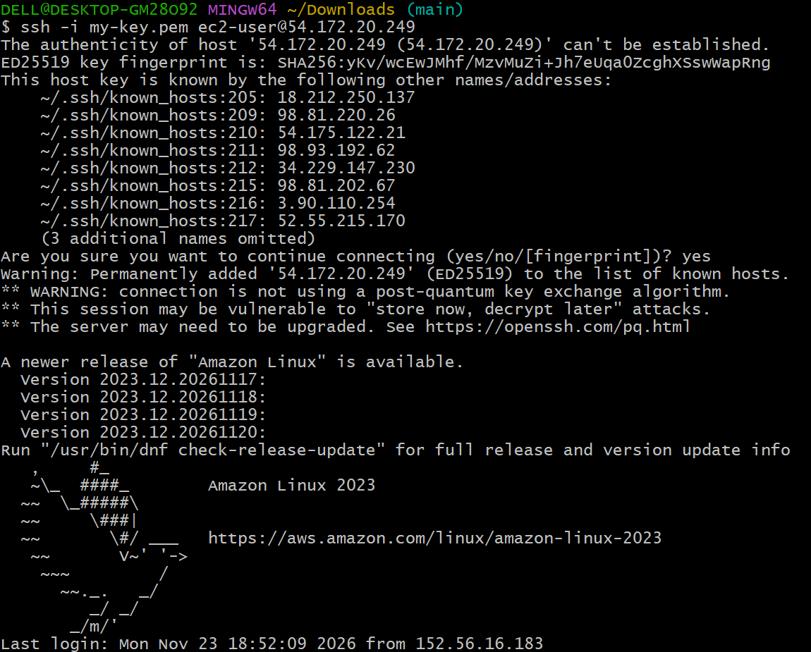

---

## Step 3: Install and Verify Docker

### Objective

Installed Docker on the Amazon Linux EC2 instance and verified that the Docker service was running.

### Commands

```bash
sudo yum update -y
```

```bash
sudo yum install docker -y
```

```bash
sudo systemctl start docker
```

```bash
sudo systemctl enable docker
```

### Verify Docker Installation

```bash
docker --version
```

```bash
sudo systemctl status docker
```

### Purpose

Docker provides the containerization environment required to run the web, application, and database services independently.

### Screenshot

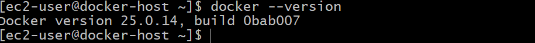

---

## Step 4: Create the Project Directory Structure

### Objective

Created the directory structure required for the three-tier application.

### Directory Structure

```bash
mkdir -p three-tier-docker/app/code
mkdir -p three-tier-docker/db
mkdir -p three-tier-docker/web/code
mkdir -p three-tier-docker/web/config
```

### Purpose

Organizes the application source code, database configuration, web server configuration, and Docker files into separate directories.

### Screenshot

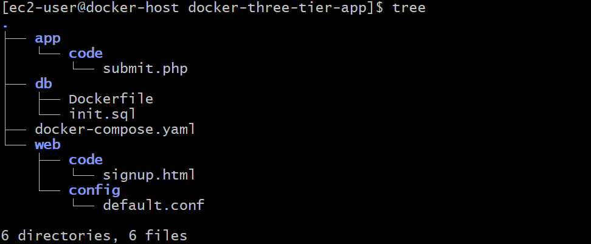

---

## Step 5: Configure the Web Tier

### Objective

Created the signup page and configured Nginx to serve the frontend application.

### Files Used

```text
web/
├── code/
│   └── signup.html
│
└── config/
    └── default.conf
```

### Purpose

Nginx acts as the web server and handles incoming HTTP requests for the frontend application.

The signup page provides the user interface through which users can submit information.

### Screenshot

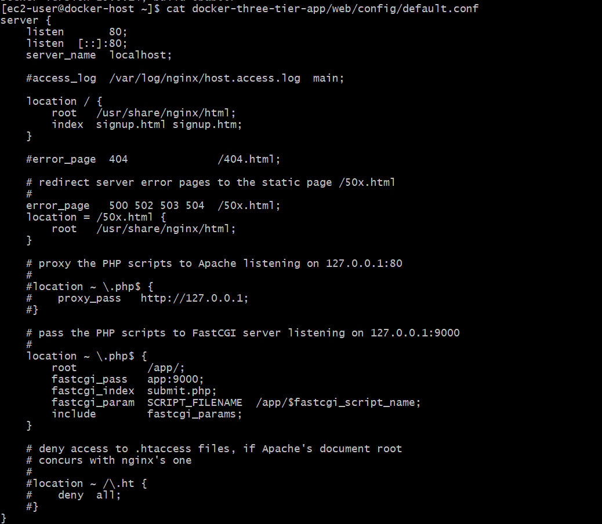

---

## Step 6: Configure the Application Tier

### Objective

Created a PHP application to process signup form submissions.

### File Used

```text
app/
└── code/
    └── submit.php
```

### Purpose

The PHP application handles the backend application logic and communicates with the MySQL database to process submitted information.

### Screenshot

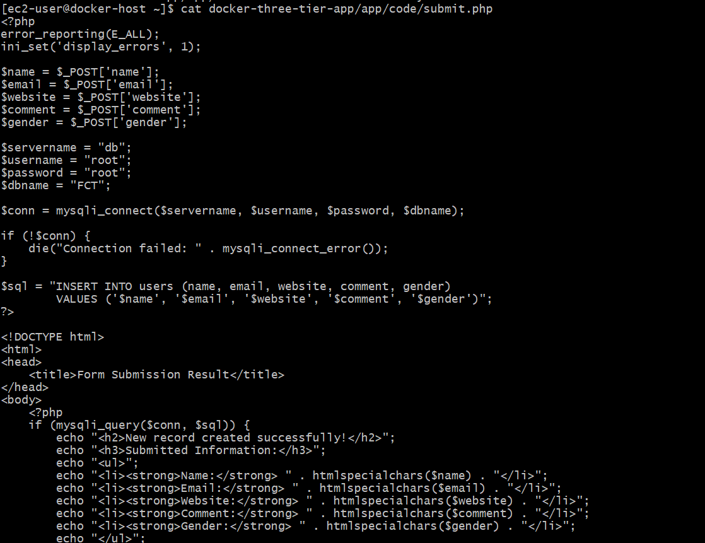

---

## Step 7: Configure the Database Tier

### Objective

Created a Dockerfile and SQL initialization script for the MySQL database.

### Files Used

```text
db/
├── Dockerfile
└── init.sql
```

### Purpose

- Dockerfile defines the database container image and its configuration.
- init.sql initializes the database schema and required database objects.

MySQL provides persistent database functionality for storing application information.

### Screenshot

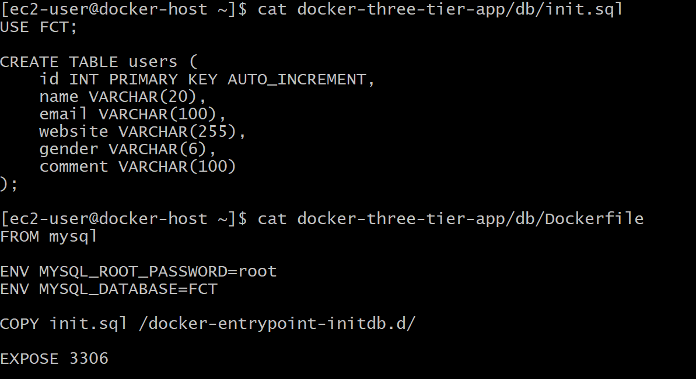

---

## Step 8: Create Docker Networks

### Objective

Created two Docker networks to separate communication between the application tiers.

### Network Architecture

| Network  | Purpose                                              |
| -------- | ---------------------------------------------------- |
| Frontend | Communication between web and application tiers      |
| Backend  | Communication between application and database tiers |

### Commands

```bash
docker network create frontend
```

```bash
docker network create backend
```

### Verify Networks

```bash
docker network ls
```

### Purpose

Docker networks allow containers to communicate with each other using isolated network connections.

The frontend and backend network separation helps organize application communication and reduces unnecessary direct connectivity.

### Screenshot

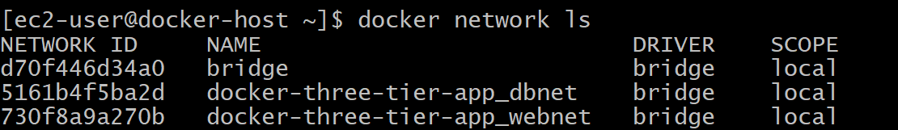

---

## Step 9: Configure Docker Compose

### Objective

Created a Docker Compose configuration file to define and manage the three application services.

### File Used

```text
docker-compose.yaml
```

### Purpose

Docker Compose simplifies multi-container application deployment by defining services, networks, configurations, and dependencies in a single YAML file.

The application uses:

- Nginx container for the web tier.
- PHP application container for the application tier.
- MySQL container for the database tier.
- Frontend and Backend Docker networks for communication.

### Screenshot

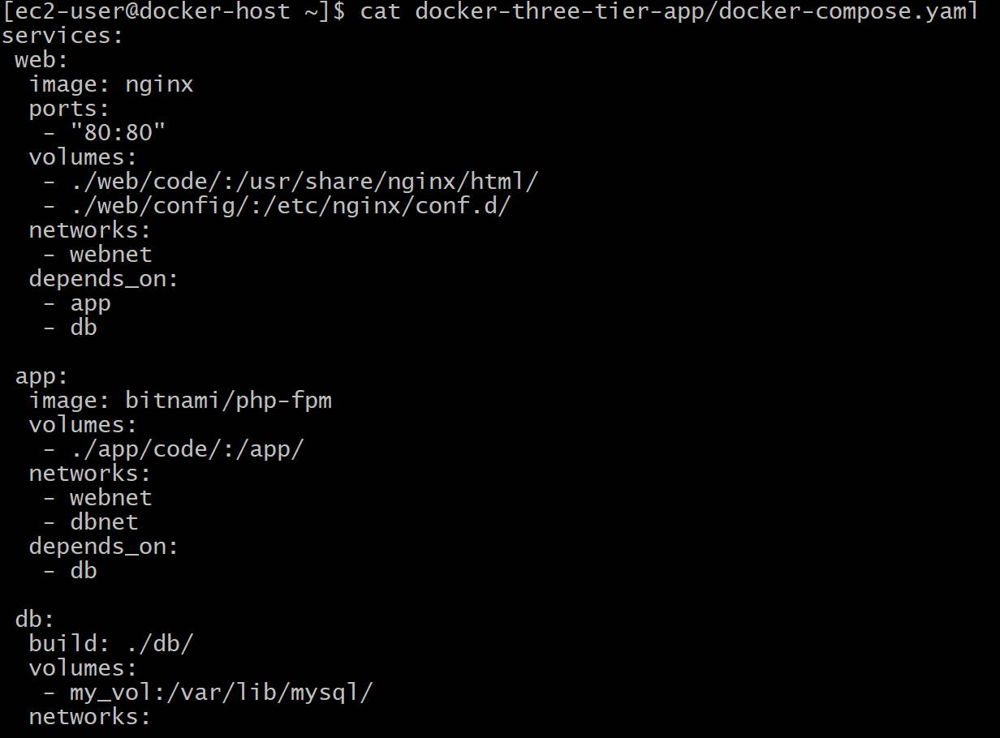

---

## Step 10: Deploy the Three-Tier Application

### Objective

Used Docker Compose to build and start the application containers.

### Commands

```bash
docker compose up -d --build
```

### Verify Running Containers

```bash
docker ps
```

### Check Container Status

```bash
docker compose ps
```

### Purpose

The command builds the required images and starts the application services in detached mode.

Docker Compose manages the application containers according to the configuration file.

### Screenshot

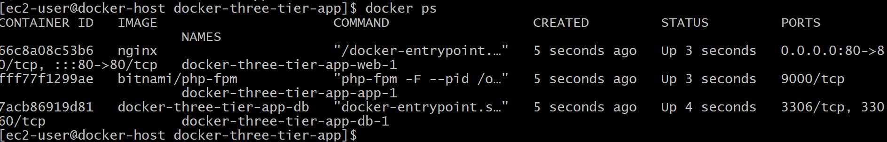

---

## Step 11: Verify Docker Network Connectivity

### Objective

Verified the Docker networks and container connectivity.

### Commands

```bash
docker network ls
```

```bash
docker network inspect frontend
```

```bash
docker network inspect backend
```

### Purpose

Network inspection helps verify which containers are connected to each Docker network.

The application tier communicates with the web and database tiers through their respective network connections.

### Screenshot

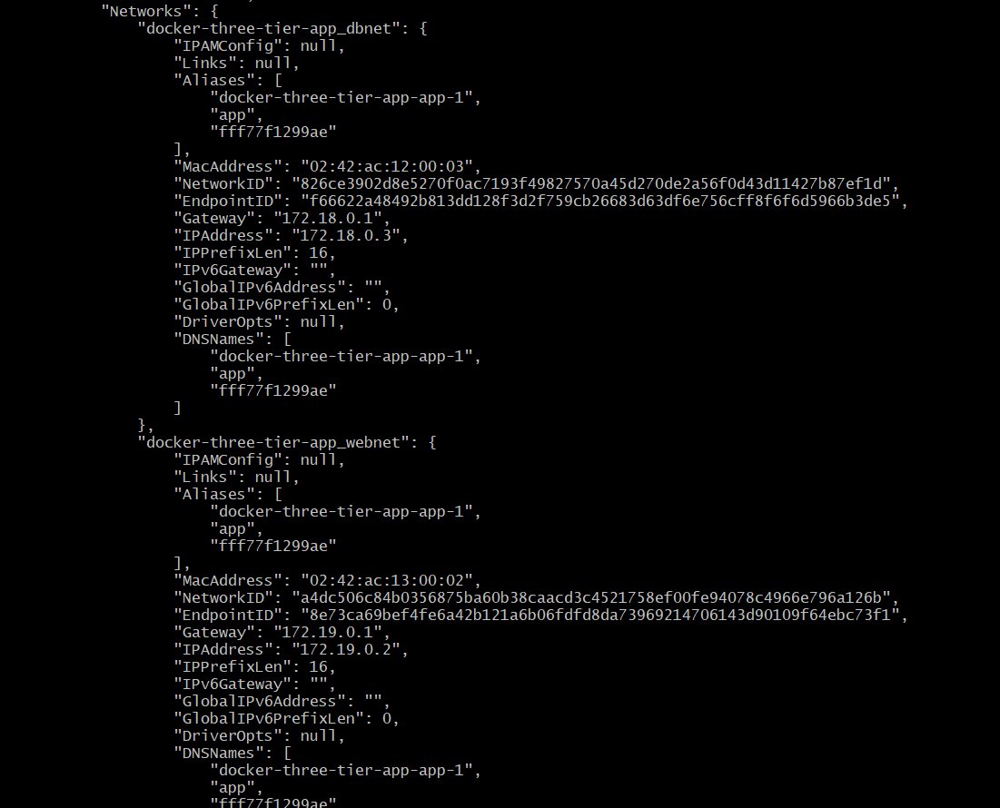

---

## Step 12: Test the Application

### Objective

Accessed the signup application through the configured web server endpoint and tested the signup functionality.

### Application Testing

- Opened the signup page in a web browser.
- Entered the required signup information.
- Submitted the form.
- Verified PHP application processing.
- Verified database connectivity and data handling.

### Purpose

Testing confirms that the web, application, and database tiers communicate successfully.

### Screenshot

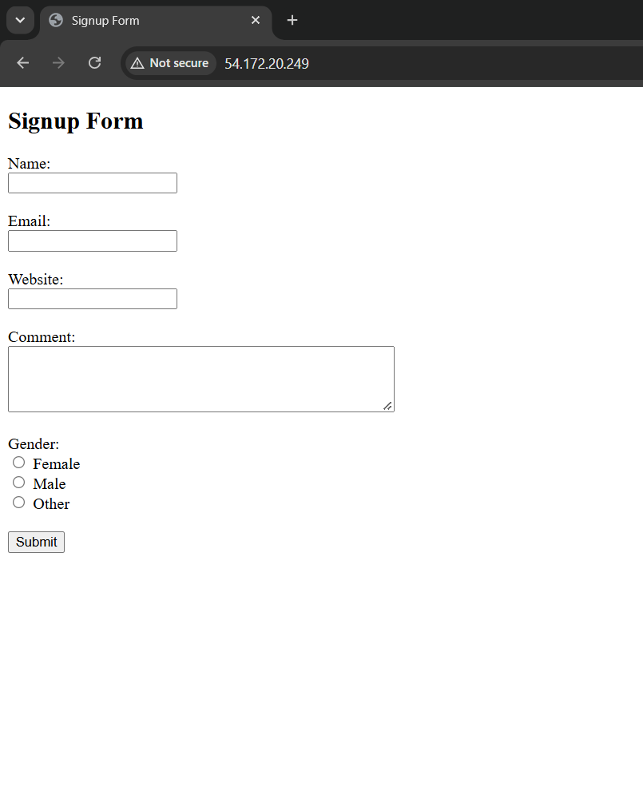

---

## Step 13: Verify Database Functionality

### Objective

Verified that the MySQL database was accessible and the application could communicate with it.

### Commands

```bash
docker ps
```

```bash
docker compose logs
```

### Purpose

Container logs and database checks help validate application execution and identify database connectivity issues.

### Screenshot


---

# Commands Used

## Connect to EC2

```bash
ssh -i your-key.pem ec2-user@<PUBLIC-IP>
```

## Install Docker

```bash
sudo yum install docker -y
```

## Start Docker

```bash
sudo systemctl start docker
```

## Enable Docker

```bash
sudo systemctl enable docker
```

## Verify Docker

```bash
docker --version
```

## Create Docker Networks

```bash
docker network create frontend
docker network create backend
```

## List Docker Networks

```bash
docker network ls
```

## Build and Start Containers

```bash
docker compose up -d --build
```

## List Running Containers

```bash
docker ps
```

## Verify Compose Services

```bash
docker compose ps
```

## View Container Logs

```bash
docker compose logs
```

## Inspect Docker Networks

```bash
docker network inspect frontend
docker network inspect backend
```

## Stop Application

```bash
docker compose down
```

---

# Testing & Validation

The following validations were performed:

| Test                    | Expected Result                         |
| ----------------------- | --------------------------------------- |
| EC2 SSH Connection      | Successful remote login                 |
| Docker Installation     | Docker installed and running            |
| Docker Network Creation | Frontend and Backend networks available |
| Container Deployment    | Application containers running          |
| Nginx Web Server        | Signup page accessible                  |
| PHP Application         | Form submission processed               |
| MySQL Database          | Database connectivity successful        |
| End-to-End Testing      | Signup application successfully tested  |

### Application Validation

The application was tested to verify communication between the three logical tiers.

### Screenshot

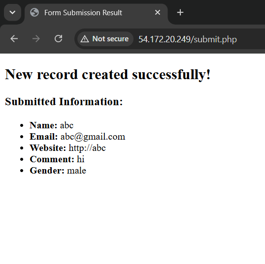

---

# Issues Encountered & Fixes

## Issue 1: Docker Installation Problems

### Solution

- Updated Amazon Linux packages.
- Installed Docker.
- Started the Docker service.
- Enabled Docker to start automatically.

---

## Issue 2: Docker Network Connectivity

### Solution

- Verified frontend and backend network creation.
- Inspected Docker network configurations.
- Checked container network attachments.

---

## Issue 3: Container Startup Problems

### Solution

```bash
docker ps -a
```

```bash
docker compose logs
```

Checked container status and logs to identify startup errors.

---

## Issue 4: Database Connectivity Problems

### Solution

- Verified MySQL container status.
- Checked database initialization.
- Verified application database connection settings.
- Inspected container logs.

---

## Issue 5: Application Access Problems

### Solution

- Verified Nginx configuration.
- Checked application container status.
- Verified the EC2 Security Group inbound rules.
- Checked the configured web server port.

---

# Learning Outcomes

Through this project, I learned:

- Deploying containerized applications on AWS EC2.
- Installing and managing Docker on Amazon Linux.
- Understanding three-tier application architecture.
- Creating and managing Docker networks.
- Separating frontend and backend communication.
- Configuring Nginx as a web server.
- Using PHP for backend application processing.
- Integrating PHP with MySQL.
- Managing multiple containers using Docker Compose.
- Testing application and database connectivity.
- Troubleshooting container and networking issues.
- Understanding containerized cloud application deployment.

---

# Conclusion

This project successfully demonstrated the deployment of a three-tier web application using Docker, Docker Compose, Nginx, PHP, and MySQL on an Amazon Linux EC2 instance.

By creating separate Frontend and Backend Docker networks, configuring individual application components, and managing services through Docker Compose, I gained practical experience with containerization and multi-tier application architecture.

The project provided hands-on experience with AWS EC2, Docker networking, web server configuration, backend application processing, and database integration.

This project establishes a strong foundation for future DevOps projects involving container orchestration, CI/CD pipelines, microservices, and scalable cloud infrastructure.

---

# Author

**DevOps & AWS Cloud Learning Journey**

GitHub: [Your GitHub Profile](https://github.com/poojathakre08)
